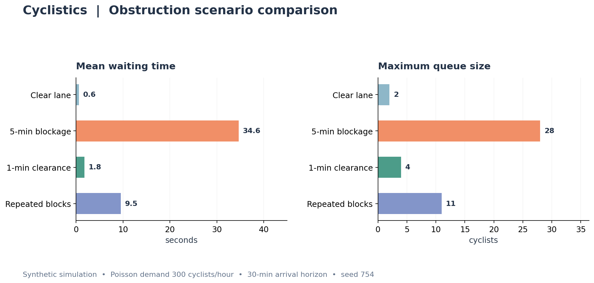
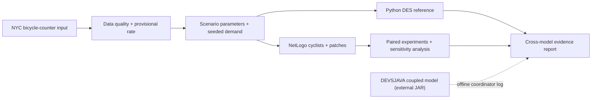

# Cyclistics 🚴

**Reproducible simulation of bicycle-lane obstructions and cyclist delays**<br>
*CSC 754 — Topics in System Simulation · College of Staten Island*


Cyclistics investigates how bicycle-lane obstructions, cyclist arrival intensity, and hypothetical clearance policies influence **simulated** queueing, waiting time, and bottleneck throughput. The implemented research prototype includes **independently executed** Python discrete-event, Java coupled-DEVS, and NetLogo cyclist-agent models, with NYC bicycle-counter data tools and reproducible experiments.

> **Current status (November 14, 2026, New York time):** PRs #5–#7 are merged into `main`. Python DES, Java DEVS-Suite atomic/coupled models, standalone NetLogo ABM, NYC bicycle-count input tools, 160-pair NetLogo sensitivity evidence and a real 36-trial GitHub-hosted NetLogo runtime benchmark are implemented. **151 automated Python tests** and all four CI jobs passed on merged `main` (`cef4aa7`). The historical DEVS-Suite 2.1 coordinator reproduced only a two-cyclist fixture (departures at 14 s/24 s); Java and NetLogo are not live-coupled. Real-world NYC queues, delays and crash risks are **not field validated**. Roboflow and ArcGIS remain future work.

## Example output — synthetic scenarios



*Demo inputs: synthetic Poisson arrivals at 300 cyclists/hour, 30-minute arrival window, random seed 754. See the [CSV output](examples/results/scenario_metrics.csv) and [assumptions](docs/reproducibility.md).*

## Run with Docker (recommended)

Install Docker Desktop (Windows/macOS) or Docker Engine with Compose (Linux). From the project root:

```bash
docker compose run --build --rm simulation
```

The resulting metrics, event schedules, and traces are written to `outputs/` on your computer.

Run the tests in Docker:

```bash
docker compose run --build --rm tests
```

Run another synthetic demand level:

```bash
docker compose run --rm simulation python -m cyclistics --rate 450 --seed 754 --output-dir /app/outputs
```

**Scope of Docker:** It runs the Python simulation, analysis modules, and source-level tests; it does **not** run the NetLogo desktop GUI or bundle an external DEVS-Suite JAR. The integrated Java model requires a separately obtained compatible DEVS-Suite JAR for its real coordinator. Headless NetLogo is also exercised separately through [GitHub Actions](.github/workflows/netlogo-performance.yml); the Python Docker test image does not run the NetLogo GUI. See [reproducibility](docs/reproducibility.md) for Linux bind-mount notes.

## Run with Python

Python 3.11 or newer:

```bash
python -m pip install -e .
cyclistics --rate 300 --seed 754 --output-dir outputs
python -m unittest discover -s tests -v
```

The simulator itself requires no third-party Python runtime dependencies.

## Interactive Event Inspector + Policy Lab (Python DES)

A dark-mode browser lab can replay **actual Python reference event traces**, inspect the post-event queue/phase, step through same-time ordering, and compare no blockage versus normal/early clearance under identical seeded arrivals. The viewer is **not** the NetLogo GUI, an executed Java coordinator trace, or a live NYC digital twin.

~~~powershell
python -m pip install -e .
python -m cyclistics.visual_lab --output outputs/visual_lab.json
python -m http.server 8000 --directory web
~~~

Open `http://localhost:8000/lab.html` and import `outputs/visual_lab.json`. See [the visual lab guide](docs/visual_lab_quickstart.md) for experiments, verification, and limitations. The ArcGIS map remains separately available at `http://localhost:8000/`.

## Research objectives

1. Compare the effect of obstruction duration on simulated waiting time and queue length.
2. Estimate how hypothetical faster clearance changes delays under identical arrivals.
3. Examine sensitivity to cyclist demand, event timing, and bottleneck assumptions.
4. Use NetLogo to test how individually different cyclists form queues in a **single lane** under clear versus blocked conditions. Overtaking and lane changes have not been implemented.

## Architecture



These models are **not** live-coupled. The Python/Java comparison uses one shared deterministic fixture; NetLogo is compared internally under matched draws. NYC counts can inform the demand rate, but simulated delays are not validated against NYC trajectories.

## Run the integrated DEVSJAVA model

The external DEVS-Suite library is **not distributed by this repository**. Place a compatible JAR in `devsjava/vendor/` locally (see [vendor instructions](devsjava/vendor/README.md)); the historical 2.1 JAR is **not** proven to be the exact CSC 754 course distribution. Docker Desktop is required for these scripts.

```powershell
.\devsjava\scripts\verify-real-devsjava.ps1
.\devsjava\scripts\run-real-coupled.ps1
```

The coordinator's deterministic fixture uses two arrivals, a scheduled obstruction, and a fixed service headway. The observed departures were **14 s and 24 s**. The Python and Java implementations agreed for that fixture; this is **verification, not field validation**.

The merged `main` suite passed **151 Python/source-level tests** on November 14, 2026, with all four CI jobs green ([GitHub run](https://github.com/rainrunner20/Cyclistics-CSC-754-Final-Project/actions/runs/43667009570)). The external Java coordinator and actual NetLogo headless engine have separate verification evidence; they are **not** exercised by the Python-only test count.

[Final integration verification](docs/final_integration_verification.md) · [External DEVSJAVA setup](docs/devsjava_runtime_check.md)

## NetLogo single-lane demonstration

Open `netlogo/Cyclistics_Bike_Lane_ABM.nlogo` in **NetLogo 6.3.0**. The green bike lane, cyclists, truck, and live queue plot are real desktop UI elements. The asphalt, separator, and sidewalk provide **schematic visual context only**; cyclists still move on the single center row. Set arrival rate, blockage timing, random seed, and run length, then click **Compare clear vs blocked** (while the continuous **go** button is stopped) to export `outputs/netlogo_paired_results.csv`.

A controlled regression of the pre-visual and enhanced versions used **600 cyclists/hour**, blockage **45–110 s**, seed **754**, and **600 simulated seconds**. Both exported CSV files matched byte-for-byte by SHA-256, and **138 Python/source-level tests passed**. This confirms identical recorded outputs for that case, not equivalence for every possible configuration.

[NetLogo visual design](docs/netlogo_visual_design.md) · [Desktop verification and comparison results](docs/netlogo_visual_regression_results.md) · [Cross-model comparison](docs/cross_model_comparison_results.md)

## Research evidence for CSC 754

The NetLogo sensitivity study uses **4 demand rates × 4 obstruction durations × 10 random seeds** (160 paired records). The research exporter validates a **real NetLogo CSV**, then produces a 16-row paper table, two queue-response SVG figures, and an evidence manifest with SHA-256 provenance. The program does **not** generate or invent experimental observations.

A completed local NetLogo study produced **160 validated paired records**; the [findings report](docs/research_sensitivity_findings.md) records all 16 averages and approximate t intervals. To reproduce them from your **original local** `outputs/netlogo_sensitivity_raw.csv` (not committed), run:

```powershell
docker compose run --build --rm simulation python -m cyclistics.research_evidence --input /app/outputs/netlogo_sensitivity_raw.csv --model /app/netlogo/Cyclistics_Bike_Lane_ABM.nlogo --output-dir /app/outputs/research_evidence
```

The paired 95% intervals quantify variation among **simulated** replicates, not measured NYC delays or statistical agreement with the Java DEVS model. The largest tested mean-queue effect, at 900 cyclists/hour and a 120-second obstruction, was **+3.369 waiting cyclists** (individual approximate 95% t interval **2.940–3.798**); it is a difference in *mean waiting counts*, not extra travel-time seconds.

[Milestone 3.8 research design](docs/research_evidence_plan.md) · [Copy-paste reproduction guide](docs/research_evidence_howto.md) · [Recorded sensitivity findings and uncertainty](docs/research_sensitivity_findings.md)

## Measured NetLogo runtime evidence (3.8B)

The separate GitHub Actions [headless NetLogo workflow](.github/workflows/netlogo-performance.yml) executes the **real NetLogo 6.3.0 model** on a Linux runner, validating five verification scenarios and measuring **36 runtime trials** (3 demand levels × 2 obstruction states × 2 horizons × 3 seeds). The performance exporter creates 12 summary rows, two SVG graphs and a SHA-256 manifest. The reported runtimes are **wall-clock computation times on GitHub's runner**, not NYC cyclist waiting times or a DEVSJAVA-versus-NetLogo speed comparison.

[Measured runtime results and environment](docs/performance_evidence_results.md) · [Reproduction guide](docs/performance_evidence_howto.md) · [Headless GitHub workflow](.github/workflows/netlogo-performance.yml)

## Experimental v2: vision, maps, traffic, event replay, and conflicts

After the v1 sensitivity work, Cyclistics added an **experimental** mixed-traffic system, keeping the original one-lane NetLogo model and previously recorded data intact. See the [verified extension status and evidence](docs/v2_extension_release_status.md) before citing any new outcomes.

- **Car traffic and merges:** `netlogo/Cyclistics_Mixed_Traffic_v2.nlogo` contains separate cyclist and car agents on two schematic lanes, gap-accepted cyclist merges, conservation checks, trajectory exports, and a TTC-like exposure proxy.
- **Conflict analysis:** `cyclistics.v2_conflicts` derives TTC-like and same-point crossing-gap *surrogates* from real NetLogo-generated trajectory CSVs, with source hashes. These are **not predicted crashes or measured NYC near misses**.
- **Computer vision:** `cyclistics.roboflow_adapter` supports optional real model inference and emits *unconfirmed* detections. Hosted image inference still requires a user's trained/selected model, credentials, and authorized actual footage.
- **ArcGIS map viewer:** `web/` contains a browser-based GeoJSON scenario viewer with time filters and provenance labels; it requires real source-backed WGS84 coordinates for map pins, not schematic NetLogo patch coordinates.
- **Offline coordination:** `cyclistics.v2_demo` and `cyclistics.v2_event_bridge` create validated synthetic events; Java 17 parses their actual exported CSV; real headless NetLogo reads and runs the same event schedule. The [GitHub integrated run](https://github.com/rainrunner20/Cyclistics-CSC-754-Final-Project/actions/runs/43671793377) passed, and the **186-test** Python suite passed. The new configurable Java DEVS-Suite runner still needs a genuine local external-JAR test. This is *offline replay*, not live bidirectional synchronization.

[Quickstart](docs/v2_integrations_quickstart.md) · [Mixed-traffic results](docs/v2_mixed_traffic_results.md) · [Trajectory conflict methods](docs/v2_conflict_proxy_methods.md) · [End-to-end replay evidence](docs/v2_end_to_end_offline_demo.md)

## Baseline experiments

| Scenario | Obstruction | Comparison |
|---|---|---|
| Clear lane | No obstruction | Control |
| Five-minute block | 300–600 s | Queue buildup |
| Faster clearance | 300–360 s | Hypothetical intervention |
| Repeated blocks | 300–420 s and 750–870 s | Recurrent disruption |

The Python reference is a **single-bottleneck, FIFO, priority-queue event simulator** with deterministic ties. Each scenario receives the same seeded arrival realization for fair comparisons. It is not a route-planning or full cyclist trajectory model.

## Repository structure

```text
cyclistics/
├── .github/workflows/ci.yml   # Python matrix and Docker smoke checks
├── src/cyclistics/            # Working reference simulator + CLI
├── tests/                     # Unit tests and timing edge cases
├── devsjava/                  # Java atomic/coupled models, scripts, adapter tests
├── netlogo/                   # NetLogo ABM source and runnable .nlogo
├── examples/results/          # Synthetic reproducibility fixture
├── docs/                      # Architecture, methods, roadmap, setup
├── outputs/                   # Generated results (gitignored)
├── data/                      # Input datasets (gitignored)
├── Dockerfile
├── compose.yaml
└── pyproject.toml
```

## Course relevance

Cyclistics demonstrates event-list scheduling and FIFO queues (Python DES), DEVS atomic/coupled models and a coordinator-driven clock (integrated Java source), NetLogo ABM with spatial patches, reproducible paired experiments, and verification versus real-world validation. The [roadmap](docs/roadmap.md) and [submission evidence ledger](docs/final_submission_status.md) distinguish completed features from future extensions.

## Documentation

[Current architecture](docs/architecture.md) · [V2 experimental status](docs/v2_extension_release_status.md) · [Project scope](docs/project_scope.md) · [Final status and evidence](docs/final_submission_status.md) · [Paper/presentation blueprint](docs/final_report_presentation_plan.md) · [Reproducibility](docs/reproducibility.md) · [GitHub publishing](docs/github_setup.md) · [Roadmap](docs/roadmap.md) · [Contributing](CONTRIBUTING.md)

## License

MIT ([LICENSE](LICENSE)). Experimental academic research software; not a road-safety operational system.
