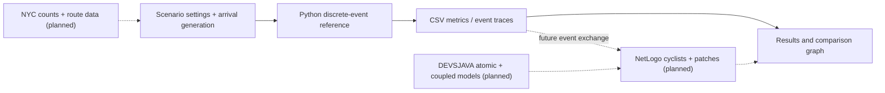

# Cyclistics 🚴

**Reproducible simulation of bicycle-lane obstructions and cyclist delays**<br>
*CSC 754 — Topics in System Simulation · College of Staten Island*

`Python 3.11+` · `Docker-ready` · `CI workflow included` · `Research prototype v0.2.0`

Cyclistics investigates how bicycle-lane obstructions, cyclist arrival intensity, and hypothetical clearance policies influence **simulated** queueing, waiting time, and bottleneck throughput. The long-term architecture combines **DEVSJAVA discrete-event models** with a **NetLogo agent-based cycling model** and selected NYC transportation datasets.

> **Implementation status:** This repo contains a **working Python discrete-event reference simulator** and tests. Formal DEVSJAVA models, NetLogo agents, field-data calibration, computer vision, and ArcGIS visualizations are **planned**. All included example results are synthetic—not measured NYC impacts, travel predictions, or crash-risk estimates.

## Example output — synthetic scenarios


*Demo inputs: synthetic Poisson arrivals at 300 cyclists/hour, 30-minute arrival window, random seed 754. See the [CSV output](examples/results/scenario_metrics.csv) and [assumptions](docs/reproducibility.md).*

## Run with Docker (recommended)

Install Docker Desktop (Windows/macOS) or Docker Engine with Compose (Linux). From the project root:

```bash
docker compose run --build --rm simulation
```

The resulting metrics, event schedules, and traces are written to `outputs/` on your computer.

Run the tests in Docker:

```bash
docker compose run --build --rm tests
```

Run another synthetic demand level:

```bash
docker compose run --rm simulation python -m cyclistics --rate 450 --seed 754 --output-dir /app/outputs
```

**Scope of Docker:** It currently packages **only the working Python reference simulator**, not the professor-specific DEVSJAVA distribution or the NetLogo desktop GUI. See [reproducibility](docs/reproducibility.md) for Linux bind-mount notes.

## Run with Python

Python 3.11 or newer:

```bash
python -m pip install -e .
cyclistics --rate 300 --seed 754 --output-dir outputs
python -m unittest discover -s tests -v
```

The simulator itself requires no third-party Python runtime dependencies.

## Research objectives

1. Compare the effect of obstruction duration on simulated waiting time and queue length.
2. Estimate how hypothetical faster clearance changes delays under identical arrivals.
3. Examine sensitivity to cyclist demand, event timing, and bottleneck assumptions.
4. **Planned:** use NetLogo to test how heterogeneous cyclists respond to blocked lanes and how lane-change exposure emerges.

## Architecture



Solid arrows are implemented. Dotted arrows represent future work; the future DEVSJAVA–NetLogo interchange is not yet live real-time co-simulation.

## Baseline experiments

| Scenario | Obstruction | Comparison |
|---|---|---|
| Clear lane | No obstruction | Control |
| Five-minute block | 300–600 s | Queue buildup |
| Faster clearance | 300–360 s | Hypothetical intervention |
| Repeated blocks | 300–420 s and 750–870 s | Recurrent disruption |

The Python reference is a **single-bottleneck, FIFO, priority-queue event simulator** with deterministic ties. Each scenario receives the same seeded arrival realization for fair comparisons. It is not a route-planning or full cyclist trajectory model.

## Repository structure

```text
cyclistics/
├── .github/workflows/ci.yml   # Python matrix and Docker smoke checks
├── src/cyclistics/            # Working reference simulator + CLI
├── tests/                     # Unit tests and timing edge cases
├── devsjava/                  # Formal DEVS implementation (planned)
├── netlogo/                   # Cyclist agent-based model (planned)
├── examples/results/          # Synthetic reproducibility fixture
├── docs/                      # Architecture, methods, roadmap, setup
├── outputs/                   # Generated results (gitignored)
├── data/                      # Input datasets (gitignored)
├── Dockerfile
├── compose.yaml
└── pyproject.toml
```

## Course relevance

Cyclistics is designed around DEVS atomic/coupled models, event scheduling, simulation clocks, state transitions, simultaneous events, NetLogo ABM, cellular space, model verification/validation, sensitivity analysis, and simulation performance. See the [roadmap](docs/roadmap.md) for which parts are built vs. planned.

## Documentation

[Architecture](docs/architecture.md) · [Project scope](docs/project_scope.md) · [Reproducibility](docs/reproducibility.md) · [GitHub publishing](docs/github_setup.md) · [Roadmap](docs/roadmap.md) · [Contributing](CONTRIBUTING.md)

## License

MIT ([LICENSE](LICENSE)). Experimental academic research software; not a road-safety operational system.
