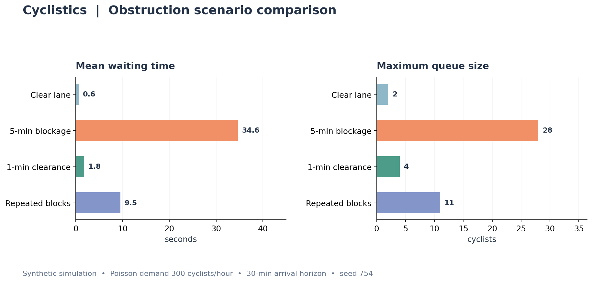
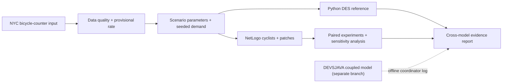

# Cyclistics 🚴

**Reproducible simulation of bicycle-lane obstructions and cyclist delays**<br>
*CSC 754 — Topics in System Simulation · College of Staten Island*


Cyclistics investigates how bicycle-lane obstructions, cyclist arrival intensity, and hypothetical clearance policies influence **simulated** queueing, waiting time, and bottleneck throughput. The long-term architecture combines **DEVSJAVA discrete-event models** with a **NetLogo agent-based cycling model** and selected NYC transportation datasets.

> **Implementation status (November 2026):** Python DES, a standalone NetLogo cyclist ABM, NYC bicycle-counter ingestion/quality checks, paired experiments, sensitivity analysis, and model-comparison tooling are implemented on the current development branch. The DEVSJAVA atomic/coupled code and real DEVS-Suite coordinator runner are maintained on the separate `feat/devs-atomic-models` branch and were verified on a two-cyclist deterministic scenario; they have **not yet been integrated into this branch**. Roboflow and ArcGIS remain optional future work. Simulated queues/delays are not field-validated NYC outcomes.

## Example output — synthetic scenarios



*Demo inputs: synthetic Poisson arrivals at 300 cyclists/hour, 30-minute arrival window, random seed 754. See the [CSV output](examples/results/scenario_metrics.csv) and [assumptions](docs/reproducibility.md).*

## Run with Docker (recommended)

Install Docker Desktop (Windows/macOS) or Docker Engine with Compose (Linux). From the project root:

```bash
docker compose run --build --rm simulation
```

The resulting metrics, event schedules, and traces are written to `outputs/` on your computer.

Run the tests in Docker:

```bash
docker compose run --build --rm tests
```

Run another synthetic demand level:

```bash
docker compose run --rm simulation python -m cyclistics --rate 450 --seed 754 --output-dir /app/outputs
```

**Scope of Docker:** It runs the Python simulation, analysis modules, and source-level tests; it does **not** run the NetLogo desktop GUI or bundle an external DEVS-Suite JAR. The external Java implementation lives on a separate feature branch. See [reproducibility](docs/reproducibility.md) for Linux bind-mount notes.

## Run with Python

Python 3.11 or newer:

```bash
python -m pip install -e .
cyclistics --rate 300 --seed 754 --output-dir outputs
python -m unittest discover -s tests -v
```

The simulator itself requires no third-party Python runtime dependencies.

## Research objectives

1. Compare the effect of obstruction duration on simulated waiting time and queue length.
2. Estimate how hypothetical faster clearance changes delays under identical arrivals.
3. Examine sensitivity to cyclist demand, event timing, and bottleneck assumptions.
4. Use NetLogo to test how individually different cyclists form queues in a **single lane** under clear versus blocked conditions. Overtaking and lane changes have not been implemented.

## Architecture



These models are **not** live-coupled. The Python/Java comparison uses one shared deterministic fixture; NetLogo is compared internally under matched draws. NYC counts can inform the demand rate, but simulated delays are not validated against NYC trajectories.

## NetLogo single-lane demonstration

Open `netlogo/Cyclistics_Bike_Lane_ABM.nlogo` in **NetLogo 6.3.0**. The green bike lane, cyclists, truck, and live queue plot are real desktop UI elements. The asphalt, separator, and sidewalk provide **schematic visual context only**; cyclists still move on the single center row. Set arrival rate, blockage timing, random seed, and run length, then click **Compare clear vs blocked** (while the continuous **go** button is stopped) to export `outputs/netlogo_paired_results.csv`.

A controlled regression of the pre-visual and enhanced versions used **600 cyclists/hour**, blockage **45–110 s**, seed **754**, and **600 simulated seconds**. Both exported CSV files matched byte-for-byte by SHA-256, and **138 Python/source-level tests passed**. This confirms identical recorded outputs for that case, not equivalence for every possible configuration.

[NetLogo visual design](docs/netlogo_visual_design.md) · [Desktop verification and comparison results](docs/netlogo_visual_regression_results.md) · [Cross-model comparison](docs/cross_model_comparison_results.md)

## Baseline experiments

| Scenario | Obstruction | Comparison |
|---|---|---|
| Clear lane | No obstruction | Control |
| Five-minute block | 300–600 s | Queue buildup |
| Faster clearance | 300–360 s | Hypothetical intervention |
| Repeated blocks | 300–420 s and 750–870 s | Recurrent disruption |

The Python reference is a **single-bottleneck, FIFO, priority-queue event simulator** with deterministic ties. Each scenario receives the same seeded arrival realization for fair comparisons. It is not a route-planning or full cyclist trajectory model.

## Repository structure

```text
cyclistics/
├── .github/workflows/ci.yml   # Python matrix and Docker smoke checks
├── src/cyclistics/            # Working reference simulator + CLI
├── tests/                     # Unit tests and timing edge cases
├── devsjava/                  # Java docs / feature work on separate branch
├── netlogo/                   # NetLogo ABM source and runnable .nlogo
├── examples/results/          # Synthetic reproducibility fixture
├── docs/                      # Architecture, methods, roadmap, setup
├── outputs/                   # Generated results (gitignored)
├── data/                      # Input datasets (gitignored)
├── Dockerfile
├── compose.yaml
└── pyproject.toml
```

## Course relevance

Cyclistics demonstrates event-list scheduling and FIFO queues (Python DES), DEVS atomic/coupled models and a coordinator-driven clock (in a separate Java feature branch), NetLogo ABM with spatial patches, reproducible paired experiments, and verification versus real-world validation. The [roadmap](docs/roadmap.md) contains earlier planning context; milestone results and current branch state are more authoritative.

## Documentation

[Architecture](docs/architecture.md) · [Project scope](docs/project_scope.md) · [Reproducibility](docs/reproducibility.md) · [GitHub publishing](docs/github_setup.md) · [Roadmap](docs/roadmap.md) · [Contributing](CONTRIBUTING.md)

## License

MIT ([LICENSE](LICENSE)). Experimental academic research software; not a road-safety operational system.
