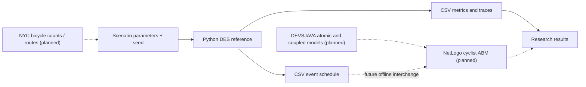

# Architecture & interface contracts

## Current state (v0.2.0)

Solid arrows are implemented; dotted arrows are future work. The Python model is a single FIFO queue and lane bottleneck, not a street-network model or calibrated real-world digital twin.

## CLI

`cyclistics --rate 300 --seed 754 --horizon 1800 --output-dir outputs/`

`--rate`: synthetic cyclists per hour. `--seed`: fixed random seed. `--horizon`: arrival observation horizon in seconds. `--output-dir`: path to CSV files.

## CSV contracts

| File | Columns | Notes |
|---|---|---|
| `scenario_metrics.csv` | `scenario`, `arrivals`, `completed_all`, `completed_by_horizon`, `mean_wait_s`, `p95_wait_s`, `max_waiting_queue`, `throughput_per_hour_during_horizon`, `assumed_freeflow_travel_s`, `mean_estimated_travel_s` | Summary per scenario |
| `trace_<scenario>.csv` | `time_s`, `event`, `queue_waiting`, `blocked`, `server_busy` | Internal trace |
| `netlogo_events_<scenario>.csv` | `time_s`, `event_type`, `value` | Future ABM input schedule |

`time_s` is simulated time and rounded to milliseconds in CSV output. It is not wall-clock time.

## Event scheduling semantics

Python reference ordering at equal timestamps is: `obstruction_end` then `obstruction_start`, then `service_complete`, then `arrival`. Within identical time/type, insertion order is stable. This ordering is a *model policy*, not a claim about DEVSJAVA defaults.

## Planned formal architecture

- Atomic **CyclistGenerator** emits cyclist arrivals.
- Atomic **ObstructionController** emits blocked/unblocked events.
- Atomic **LaneBottleneck** handles FIFO waiting, entry, and departure.
- **CyclisticsCoupled** wires the atomic models using input/output ports.

The DEVSJAVA atomic models will be coupled *inside* DEVSJAVA. Sending Java-produced CSV events to NetLogo is an offline sequential workflow, **not** a unified coupled DEVS–NetLogo simulator. Simultaneous and confluent event semantics must be specified explicitly in the eventual DEVS model.
