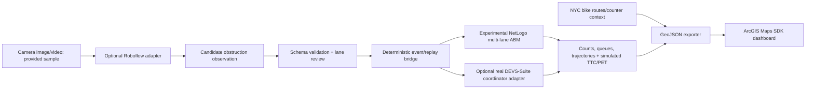

# Cyclistics — Advanced digital twin extensions (experimental scope)

**Status:** Planned; foundation contract will be developed separately. These extensions are **not** part of the completed 3.8A/3.8B experiments or their verified one-lane results.

**Goal:** Explore a camera-to-obstruction-to-simulation-to-map workflow, with adjacent motor traffic, cyclist lane-choice behavior and interpretable *surrogate traffic-conflict metrics*. Preserve the already-verified one-lane model and its original results unchanged.

## What we intend to add

| Track | Practical first result | Later integrated result | Boundary |
| --- | --- | --- | --- |
| A — Roboflow vehicle detection | Offline inference on a supplied sample image/video, with bounding boxes + confidence | Candidate obstruction observations associated with a monitored lane and timestamps | Seeing a vehicle does not prove that it blocks a bike lane |
| B — ArcGIS web dashboard | NYC base map + real bicycle-route/counter layers + imported *synthetic* simulation GeoJSON | Scenario selection, timeline, obstruction markers and queue metrics | Geolocate only where known source coordinates/segment metadata exist |
| C — Interoperability and live coordination | Versioned JSON messages and a deterministic replay bridge between Python, Java and NetLogo | Reproducible event-stream orchestration (then optional live mode) | Source-observation time != simulation time; synchronization and late/duplicate events must be explicit |
| D — Adjacent motor traffic | Experimental NetLogo multi-lane model with vehicle agents, movement and lane occupancy | Mixed bicycle/motor traffic with separate demand rates and obstruction responses | Do not replace validated one-lane NetLogo experiments |
| E — Lane changes + conflicts | Rule-based cyclist lane-change decisions and near-miss indicators based on modeled trajectories | Evaluate policy scenarios (obstructed vs clear; traffic levels; behavior) | TTC/PET are **surrogate safety measures**, not real crash probabilities |

## Architecture and safety boundaries

The diagram is a **target architecture**, not a claim of presently implemented connectivity. The completed Python, Java and single-lane NetLogo components remain independent and verifiable while experimental adapters are built.

## Deliver in real increments

### Milestone 9.0 — Interfaces and reproducibility foundation

- Version a minimal observation contract; distinguish **camera observation** from a confirmed obstruction and simulated scenario.
- Validate source timestamp (UTC), source ID, confidence, object class and whether lane overlap was *externally assessed*. Never silently convert an image detection into a real road-blockage ground truth.
- Make standalone unit tests for valid/invalid payloads, replay/deduplication edge cases and independent model compatibility.
- Keep added Python analysis standard-library-only; optional Roboflow/ArcGIS dependencies must not break existing tests or require credentials in CI.
- No changes to the original 3.8A/3.8B model, input CSV or reported findings.

### Milestone 9.1 — Experimental multi-lane NetLogo + traffic agents

- Copy the **existing** NetLogo model into a separate explicitly experimental file, not a destructive rewrite.
- Add a cyclist lane and adjacent motor-vehicle lane with patch-level occupancy/geometry, car turtles, independent seeded arrival generators and a non-wrapping exit.
- Add cyclist lane-choice rules (wait vs merge) with gap acceptance, speed/acceleration restrictions and deterministic tie handling.
- Verify no two vehicle/cyclist agents illegally occupy the same modeled segment, no teleporting or backwards movements, correct conservation and repeatable runs.
- Run matched counterfactual experiments; label all outputs model-dependent, not observed NYC behavior.

### Milestone 9.2 — Conflict surrogate analysis

- Export time-stamped cyclist/motor vehicle position and speed trajectories with consistent units (meters/second, simulated seconds) and spatial coordinates.
- Analyze **simulated** minimum time-to-collision (TTC), post-encroachment time (PET) and severe braking/unsafe-gap indicators where mathematically defined.
- Document that TTC/PET are *surrogate metrics*, not collision predictions or calibrated collision probabilities. A model without valid trajectories cannot report these metrics responsibly.
- Introduce deliberately near-conflict and safe-separation test cases; verify false positives and boundary conditions.

### Milestone 9.3 — Roboflow computer-vision adapter

- Begin with user-supplied or explicitly licensed footage and an offline fake/recorded response **clearly labeled as test data**. No claim of live camera feed unless one is actually connected.
- Use optional self-hosted inference or authorized hosted Roboflow API. Secure any key via environment secrets and keep frames out of Git.
- Export bounded and timestamped detection observations; separate confidence from confirmed lane-blockage status.
- Validate detection quality on an annotated test set (precision/recall, false positives), and manually verify geometry. A bounding box alone does not establish obstruction.

### Milestone 9.4 — Deterministic event bridge and optional real-time mode

- Make a common read-only event log/JSON contract with event ID, source, observed timestamp, canonical type, simulation target and scenario version.
- Build a deterministic **offline replay** orchestration first (Python generates event input; Java DEVS-Suite external coordinator and NetLogo each consume explicitly supported fixtures).
- Handle duplicate/out-of-order messages, exactly-once vs at-least-once semantics, late data, backpressure, replay seeds and expected time mapping.
- Only after verified replay, offer an **experimental live adapter**, with latency measures and explicit acknowledgement that NetLogo and DEVS use different logical clocks. Mere CSV transfer does not count as live coupling.

### Milestone 9.5 — ArcGIS scenario dashboard

- Use the current **ArcGIS Maps SDK for JavaScript** rather than deprecated widgets; show route/counter context, modeled obstruction events, and time-filtered synthetic queues.
- Publish actual source-provenanced GeoJSON or hosted feature layers; WGS84 coordinate contract, units and source references required. Do not invent physical street coordinates for a schematic NetLogo lane.
- Add filters for scenario, obstruction duration, seed, demand, and experimental vs observed data status. Render uncertainty and an explicit *not field validated* caption.
- Start with a static local dashboard consuming generated artifacts; streaming and hosted ArcGIS credentials remain optional.
- Map access/hosting requires Esri account setup or permitted public basemap access. Keep credentials out of GitHub.

### Milestone 9.6 — Integrated validation and reproducible demo

- Run separate CI jobs for Python contract tests, NetLogo experimental model headless, and web dashboard build.
- Record a fully reproducible **offline** demo from sample frame -> candidate observation -> selected obstruction event -> NetLogo experimental results -> dashboard view.
- An integrated *live* demo is accepted only when it actually performs timed event transfer, state changes and measurable latency; otherwise label it an offline replay demo.
- Final report must separate existing 3.8A conclusions from new multi-lane hypothetical results. No general traffic safety policy advice or numerical crash risk until field validation.

## Feasibility, dependencies and risks

| Risk | Mitigation |
| --- | --- |
| Too much work for CSC 754 submission | Finish the core paper and demo in parallel; treat every extension as optional and independently mergeable |
| Camera data / Roboflow API access | Allow offline fixture + optional provider; require account/keys only for genuine hosted inference |
| Geographic accuracy | Use actual NYC street geometries/counters with verified coordinates; keep schematic lanes in local model coordinates |
| DEVS-Java library availability | Keep optional JAR external; never require it in core CI |
| NetLogo model invalidation | Maintain a separate multi-lane file and do not overwrite proven one-lane experiment source |
| Misleading safety claims | Clearly distinguish *simulated conflict exposure*, TTC/PET and real crash probabilities |
| Uncontrolled dependencies | Pin optional versions after smoke verification; avoid changing core packaging |

## Acceptance criteria for the five requested extensions

1. **Vision:** real object detection on a genuinely provided frame and independently audited lane-obstruction decision, with labels and thresholds.
2. **Mapping:** working map page with source-grounded geographies, clearly marked hypothetical scenarios and a reproducible build.
3. **Coordination:** an end-to-end timestamped event scenario that changes simulation state through a tested interface; distinguish offline replay from real-time.
4. **Traffic:** reproducible mixed-traffic runs, cyclist/motor vehicle conservation, spacing and independent arrivals.
5. **Lane choices/conflicts:** tested gap acceptance plus trajectory-derived *surrogate safety* measures; no unsupported crash-risk probabilities.

**Release policy:** These additions are optional extensions to Cyclistics, not completed CSC 754 deliverables until implemented and tested. Keep all feature branches, use real commits/PRs, and preserve model provenance.
