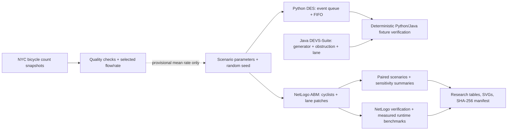

# Cyclistics — current system architecture and interface contracts

**Current implementation:** integrated Python reference DES, Java DEVS-Suite atomic/coupled model, standalone NetLogo 6.3.0 single-lane ABM, NYC counter-input preparation and research evidence tools. These are *separate simulations and analysis workflows*, not a live-connected NYC digital twin. See [final submission status](final_submission_status.md).

## System boundaries

- **Python DES:** single FIFO bottleneck, seeded Poisson arrivals, scheduled block/clear and passage events; produces trace and scenario CSVs.
- **Java DEVSJAVA-style system:** `CyclistGenerator`, `ObstructionController`, `LaneBottleneck`, and `CyclisticsCoupledModel` with port routing, atomic internal/external/confluent transitions and coordinator-managed event time.
- **NetLogo:** individual cyclist turtles on one modeled lane with 1-second global ticks, local following and blockage rules, measured queue/replay and experimental export.
- **NYC data:** ingestion/stream-quality review selects **candidate arrival rates**; no automatic merging of ambiguous count flows and no assumption that one rate validates queueing outcomes.
- **Evidence tools:** validate original CSVs, compare compatible fixtures, compute replicated statistics, measure runtime, and record source/output SHA-256 digests.

**Not integrated:** NetLogo is not driven by a real-time Java coordinator; CV, Roboflow, ArcGIS, live sensor feedback, adjacent-lane traffic and collision modeling are not part of the working runtime.

## Three clocks and their meaning

| Model | Clock | What a 'time' value means |
| --- | --- | --- |
| Python reference | Priority event list, continuous simulated seconds | Timestamp of next arrival, block/clear, or departure event |
| Java DEVS-Suite | Coordinator scheduling the next atomic transition | Simulated event time, with `ta` and elapsed `e` handling |
| NetLogo | One-second global ticks | Discrete steps of cyclist movement, obstruction and queue sampling |

**Wall-clock benchmarking** is different: the NetLogo `timer` counts how long the physical CPU spent processing simulated ticks. Its results depend on the machine.

## Python output contracts

| Output | Representative fields | Meaning |
| --- | --- | --- |
| `scenario_metrics.csv` | `scenario`, `arrivals`, `mean_wait_s`, `p95_wait_s`, `max_waiting_queue`, `throughput_per_hour_during_horizon` | Python scenario summaries |
| `trace_<scenario>.csv` | `time_s`, `event`, `queue_waiting`, `blocked`, `server_busy` | Event-level state trace |
| `netlogo_events_<scenario>.csv` | `time_s`, `event_type`, `value` | Python-produced event descriptions, **not** proof of a running NetLogo co-simulation |

The Python ordering of equal-time events is `obstruction_end`, `obstruction_start`, `service_complete`, then `arrival`; identical type/time uses stable insertion order. This is a Python reference **policy**, not a generic DEVS-Suite scheduling guarantee.

## Java coupled model ports

| Source | Output port | Target | Input port |
| --- | --- | --- | --- |
| CyclistGenerator | `arrival` | LaneBottleneck | `arrival` |
| ObstructionController | `block` | LaneBottleneck | `block` |
| ObstructionController | `clear` | LaneBottleneck | `clear` |
| LaneBottleneck | `departed` | CyclisticsCoupledModel | `departed` |

The real historical DEVS-Suite coordinator completed a deterministic fixture with cyclists entering at **10 s and 15 s**, obstruction **12–20 s**, a 4-s passage, and departures at **14 s and 24 s**. See [cross-model comparison](cross_model_comparison_results.md). General numerical equivalence between Python and Java has not been established.

## Valid experimental comparisons

- **Within NetLogo:** identical arrival/speed draws across clear and blocked runs; 4 demand rates × 4 blockage durations × 10 seeds, **160 paired records**, with individual paired t intervals for queue outcomes
- **Within Python:** same generated arrival schedule across clearance-policy scenarios
- **Python vs Java:** one intentionally shared, deterministic event fixture and reported exact departures; no general shared stochastic engine
- **NetLogo vs Python/Java:** *conceptual* comparison of modeling assumptions and clocks only, not direct parity of queue/delay numbers

For experimental data and limitations, follow the [sensitivity findings](research_sensitivity_findings.md), [performance evidence](performance_evidence_results.md), and [NYC stream-quality requirements](nyc_counter_quality_requirements.md).
